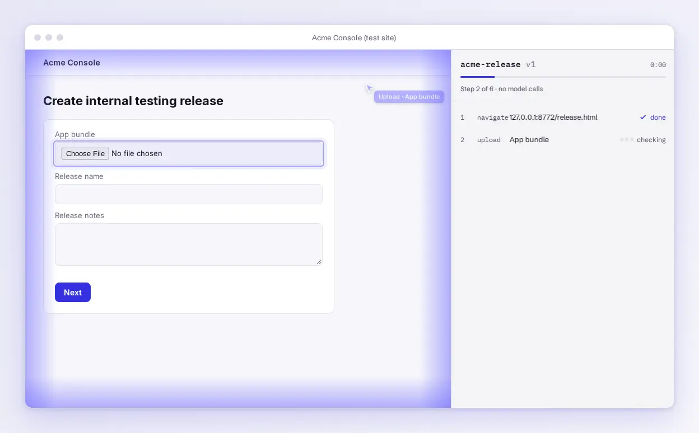
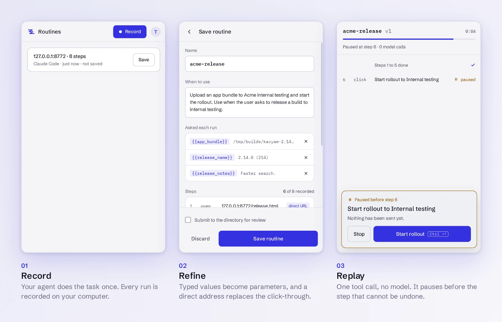
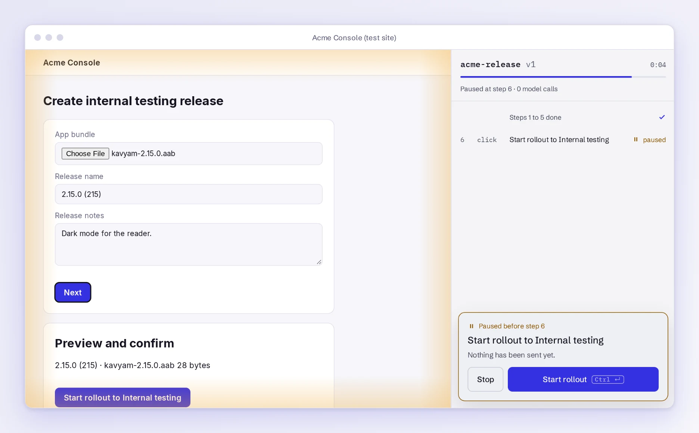
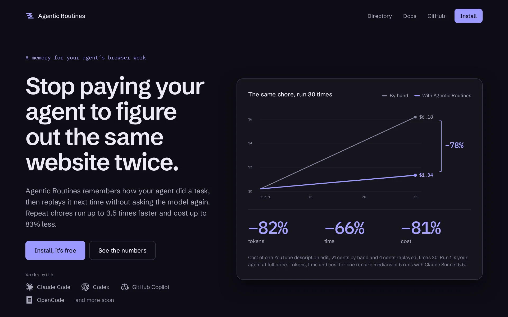

<p align="center">
  
</p>

<h1 align="center">Agentic Routines</h1>

<p align="center">
  A cache for your agent's long browser chores. Repeat tasks replay as one tool call, with no model.
</p>

<p align="center">
  <a href="LICENSE"></a>
  <a href="https://agenticroutines.arunprakashg.com">Website</a> ·
  <a href="https://agenticroutines.arunprakashg.com/docs">Docs</a> ·
  <a href="https://agenticroutines.arunprakashg.com/directory">Directory</a>
</p>

<p align="center">
  <picture>
    <source media="(prefers-color-scheme: dark)" srcset="docs/images/replay-dark.webp">
    
  </picture>
</p>

Coding agents such as Claude Code drive the browser one step at a time: read the page, think, act, repeat. Every step costs tokens and seconds, and the next run pays all of it again. Agentic Routines is the cache for that work. It is a browser extension and a tool server that sit behind your agent's browser tools, for Claude Code, Codex, GitHub Copilot and OpenCode. It does the job that tools such as Claude in Chrome do step by step, once, and then remembers it. It is made for agents, not people: you do not record or manage anything, your agent does. It works in Chrome, Edge and Firefox. It is free and open source, and so is the directory of shared routines.

## What it does

- **Record.** Everything your agent does in the browser is recorded on your computer.
- **Refine.** After a task the agent can turn the run into a routine. Values it typed become parameters, and a direct address can replace a click-through. The agent proposes, edits and tests a draft before anything is saved.
- **Replay.** A saved routine shows up as one tool, `rt_<name>`. Calling it replays the steps without a model, and the result is a few lines of text, not page snapshots.
- **Check.** Before each step the replay compares the page structure, then the element, then a screenshot crop. When a step has changed, the agent is handed the page to pick the right element, and the fix is saved.
- **Pause.** A replay stops before a step that cannot be undone, such as publishing, paying or deleting, and waits for you or your agent to approve it.
- **Repeat.** A routine can run its steps for every value in a list or every row on a page, and skip steps that only sometimes apply, such as a notice. A pause still pauses on every pass.
- **Share.** Install a routine someone else maintains, from the directory or a Git repository, and your agent skips the recording.

On the long release form in the benchmark in [`dev/bench`](dev/bench), a replay took about 27 seconds and $0.06 against 1 minute 33 seconds and $0.32 for the agent doing it by hand. Results depend on the site and the model.

Length decides whether it pays. A one-step lookup on GitHub used about 70% more tokens as a replay than by hand, and saving a routine costs about 2.3 times one run by hand (median of 6 tasks). The fit is long tasks you repeat on sites with no API or MCP server.

<p align="center">
  <picture>
    <source media="(prefers-color-scheme: dark)" srcset="docs/images/steps-dark.webp">
    
  </picture>
</p>

## Install

1. **Add the extension** from the store for your browser: Chrome, Edge or Firefox. Brave, Arc and Opera use the Chrome version. To build it yourself, see [Development](#development).
2. **Connect your agents.** One command finds them and registers the native host with every browser it finds:

   ```bash
   npx agentic-routines setup
   ```

   Restart your agent afterwards, then check the connection with `npx agentic-routines doctor`. Use `pnpm dlx`, `bunx` or `yarn dlx` in place of `npx` if you prefer. `setup --dry-run` shows what it would write first.
3. **Make your first routine.** Ask your agent to do a task in the browser the way you normally would. Then ask it to save the run as a routine, or save it from the side panel. The next time you ask for the same thing, it calls the routine.

More in [Getting started](docs/guide/getting-started.md).

## How an agent picks a routine

- When the agent opens a page, `navigate` lists the saved routines for that site.
- Each routine has a description that says what it does and when to use it, written when it was saved. That text is the tool description the agent sees, so it can choose the right one.
- `routines_list` and `routine_describe` show everything saved. `routines_search` also looks in the directory and in repositories you added.
- A replay ends as done, paused or needing a choice. The agent continues a paused replay with `routine_resume`.

`setup` also tells each agent to use Agentic Routines for all browser work and to try a saved routine first. Add `--exclusive` to turn off other browser tools, and `--remove` takes it all back out ([How agents choose](docs/guide/agents.md)). For Claude Code alone, the plugin installs with `/plugin install agentic-routines --marketplace ArunPrakashG/agentic-routines`.

The full list of tools is in [Agent tools](docs/guide/tools.md), and the loop an agent follows to save a routine is in [Refine a routine](docs/guide/refine.md).

## Routine repositories

A Git repository can hold routines for other people. Put a `config.routine` file in its root that says what the repository is, what each routine is for and what an agent should keep in mind. Anyone can add the repository as a source:

```bash
npx agentic-routines sources add github.com/owner/repository
```

Routines from a repository are not reviewed by this project. The side panel shows every step before anything is installed. The file format is in [Routine repositories](docs/guide/repositories.md), and [Sharing and publishing](docs/guide/sharing.md) covers the directory.

<p align="center">
  <picture>
    <source media="(prefers-color-scheme: dark)" srcset="docs/images/pause-dark.webp">
    
  </picture>
</p>

## Website

The [website](https://agenticroutines.arunprakashg.com) has the docs, the directory of shared routines and the numbers from the benchmark. It is built from [`apps/site`](apps/site).

<p align="center">
  
</p>

## Repository

| Path | What it is |
|---|---|
| [`packages/extension`](packages/extension) | The browser extension (WXT, Preact). One codebase for Chrome, Edge and Firefox |
| [`packages/cli`](packages/cli) | The `agentic-routines` npm package: `setup`, `doctor`, `mcp` and the native `host` |
| [`packages/core`](packages/core) | Routine format, compiler and locator matching, shared by both |
| [`packages/browsers`](packages/browsers) | Every supported browser in one table: where it keeps native host manifests, which ids it accepts |
| [`plugins/agentic-routines`](plugins/agentic-routines) | The Claude Code plugin: a skill that tells the agent to look for a routine first, and hooks. Listed by `.claude-plugin/marketplace.json` |
| [`apps/api`](apps/api) | Accounts and the directory. A Go service on Postgres and Redis |
| [`apps/site`](apps/site) | The website and docs, built with Astro |
| [`docs`](docs) | The documentation pages (`guide/`), architecture, directory guidelines and privacy |
| [`releases`](releases) | Release scripts, store listing text and every released version |
| [`design`](design) | Approved mockups and tokens |
| [`dev`](dev) | Local environment, end-to-end tests, the benchmark and the README image scripts |

Inside the larger ones:

| Path | What it is |
|---|---|
| `packages/extension/lib/` | `agent/` runs, drafts and the native host line · `replay/` the replay engine · `page/` dom, overlay, hidden-text and tab helpers · `remote/` sign-in, directory and Git sources · `panel/` side panel messages · `platform/` Chromium and Gecko |
| `packages/cli/src/` | `mcp/` the MCP server · `host/` the native host and the upload checks · `commands/` `setup`, `doctor`, `agents` and `sources` · `store/` routines and sources on disk |
| `dev/` | `env/` the local environment · `e2e/` the end-to-end checks · `images/` the README screenshots · `fixtures/` and `site/` the test data and the test site · `bench/` the benchmark |

## Development

You need Node 20 or newer and pnpm.

```bash
pnpm install
pnpm typecheck
pnpm build        # every package, including both extension builds
pnpm dev:up       # a real Chromium with the extension, the native host and Claude Code, under .dev/
pnpm e2e          # browser end to end, no model calls
pnpm e2e:api      # the API, on throwaway Postgres and Redis (Docker)
```

`pnpm e2e` drives a headless Chromium through its debugging port, 9333 by default. If something else holds that port, set `AR_CDP_PORT`:

```bash
AR_CDP_PORT=9444 pnpm e2e
```

[`dev/README.md`](dev/README.md) has the local environment, [`releases/README.md`](releases/README.md) has how a release is made, and the API and site have their own READMEs in [`apps/api`](apps/api/README.md) and [`apps/site`](apps/site/README.md). The images in this file are made by `dev/images/shots.mjs` and `dev/images/readme-images.mjs`, from a real run of the extension against a small test site.

## Contributing

Issues and pull requests are welcome. Open an issue first for anything large, so the direction is agreed before you write it. Keep a change to one thing, run `pnpm typecheck` and `pnpm e2e` before you push, and say in the pull request what you ran. The docs live in [`docs/guide`](docs/guide), and a new page is listed in `apps/site/src/lib/docs.ts`.

## Security

Routines and recordings stay on your computer. Nothing is sent unless you sign in and choose to publish, or connect your browser to an agent on another computer of yours. See [docs/privacy.md](docs/privacy.md). A routine fetched from outside is checked again on your machine before it is installed, and an edit cannot remove a pause that was detected.

Please do not report a vulnerability in a public issue. Use the repository's private vulnerability report on the Security tab.

## License

MIT. See [LICENSE](LICENSE).
